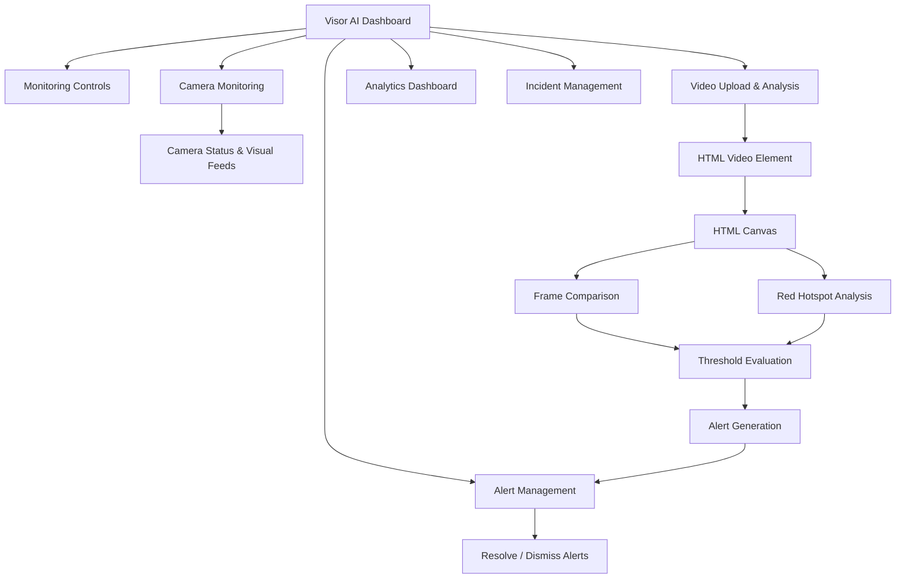

<div align="center">

# VISOR AI

### Intelligent Surveillance & Safety Monitoring Dashboard

**A modern surveillance monitoring interface for visualizing camera feeds, analyzing uploaded video recordings, managing safety alerts, and tracking security incidents.**

<br/>


<br/>

[Explore Repository](https://github.com/naitik2043/visor-ai) · [Report an Issue](https://github.com/naitik2043/visor-ai/issues)

</div>

---

## Overview

**Visor AI** is a web-based intelligent surveillance dashboard designed to bring camera monitoring, safety-event visualization, and incident management into a centralized interface.

The application provides a structured environment for monitoring multiple surveillance locations, visualizing system activity, analyzing uploaded video recordings, and managing potentially suspicious events.

It combines a responsive dashboard with browser-based video-frame analysis and interactive monitoring components to demonstrate how intelligent surveillance systems can support security and safety operations.

### Key Objectives

- Centralize surveillance monitoring through an interactive dashboard.
- Provide visibility into camera status and monitoring activity.
- Analyze uploaded video frames for motion changes and red-dominant visual regions.
- Organize alerts based on severity and location.
- Support incident tracking through searchable and filterable records.
- Visualize monitoring statistics through interactive charts.

---

## Core Features

### 1. Centralized Monitoring Dashboard

A unified dashboard providing an overview of surveillance activity and system status.

- Start and stop monitoring controls.
- System status indicators.
- Camera and active-alert counters.
- Centralized access to monitoring components.
- Responsive dashboard layout.

### 2. Multi-Camera Surveillance Interface

A camera monitoring interface designed to represent surveillance activity across multiple locations.

- Camera identification and location information.
- Online, offline, and alert states.
- Visual detection indicators.
- Monitoring status overlays.
- Support for multiple surveillance locations.

The current implementation uses sample surveillance images and simulated camera states.

### 3. Browser-Based Video Analysis

Visor AI includes a video upload component that performs basic frame-level analysis directly in the browser.

**Processing workflow:**

1. Select a video recording.
2. Load the recording using the browser's video element.
3. Extract frames using HTML Canvas.
4. Compare consecutive frames to estimate pixel-level changes.
5. Identify red-dominant pixel regions using color thresholds.
6. Calculate motion and hotspot percentages.
7. Generate alerts when configured thresholds are exceeded.

**Motion Analysis**

The application compares pixel values between consecutive frames to estimate visual changes.

**Red Hotspot Analysis**

It identifies pixels with strong red-channel dominance as a basic visual heuristic for potentially suspicious regions.

**Severity Classification**

| Condition | Alert Severity |
|---|---|
| Motion > 35% or Red Hotspots > 12% | Critical |
| Motion > 20% or Red Hotspots > 6% | High |
| Motion > 12% or Red Hotspots > 3% | Medium |
| Below configured thresholds | No alert |

*These are heuristic thresholds, not trained AI classification results. Red-dominance analysis is not a validated fire-detection method.*

### 4. Alert Management System

A centralized interface for displaying and managing generated alerts.

- Alert generation and visualization.
- Severity-based classification.
- Camera and location information.
- Timestamp tracking.
- Active and resolved alert states.
- Alert resolution and dismissal.
- Toast notifications for new events.

Supported alert categories include:

| Category | Example |
|---|---|
| PPE Violation | Missing worker safety equipment |
| Patient Fall | Potential patient fall event |
| Unauthorized Access | Entry into a restricted area |
| Unsafe Operation | Potential machinery safety violation |
| Fire Hazard | Suspicious visual hotspot |
| Security Breach | Suspicious activity in a secure zone |

### 5. Incident Management

An incident-management interface for organizing and reviewing safety and security events.

- Search incidents by title, description, and location.
- Filter incidents by severity.
- Filter incidents by status.
- View assigned personnel.
- Review incident timestamps.
- Track resolution information.
- Access incident analytics.

Supported incident statuses:

`Open` · `Investigating` · `Resolved` · `Closed`

### 6. Interactive Analytics Dashboard

Visual analytics powered by Recharts.

The dashboard includes:

| Visualization | Purpose |
|---|---|
| Detection Rate | Visualize detection activity |
| Response Time Trend | Track response-time changes |
| Hourly Incident Summary | Compare incidents and resolutions |
| System Performance | Display performance trends |

### 7. Monitoring Statistics

An overview of key monitoring indicators:

- Response Time
- Detection Accuracy
- Active Cameras
- Detection Rate

**Note:** The current demonstration generates several statistics and monitoring events using simulated data. These values are not measured model-performance benchmarks.

---

## Technology Stack

| Technology | Role |
|---|---|
| Next.js 14 | Application framework |
| React 18 | UI development |
| TypeScript | Type safety and maintainability |
| Tailwind CSS 4 | Responsive styling |
| shadcn/ui | Reusable interface components |
| Radix UI | Accessible UI primitives |
| Recharts | Interactive data visualization |
| Lucide React | Icons and visual elements |
| HTML Canvas API | Video-frame extraction and pixel analysis |
| Browser Video API | Local video playback and processing |
| Vercel Analytics | Application analytics integration |

---

## Application Architecture

The current application follows a component-based frontend architecture.



### Component Organization

The application is divided into reusable components responsible for individual dashboard features.

```text
visor-ai/
│
├── app/
│   ├── globals.css
│   ├── layout.tsx
│   └── page.tsx
│
├── components/
│   ├── alerts-panel.tsx
│   ├── incident-management.tsx
│   ├── live-charts.tsx
│   ├── stats-overview.tsx
│   ├── upload-monitor.tsx
│   ├── video-feed-grid.tsx
│   │
│   └── ui/
│       └── Reusable UI components
│
├── hooks/
│   ├── use-mobile.ts
│   └── use-toast.ts
│
├── lib/
│   └── utils.ts
│
├── public/
│   └── Surveillance images and static assets
│
├── styles/
│   └── globals.css
│
├── components.json
├── next.config.mjs
├── package.json
├── tsconfig.json
└── LICENSE
```

---

## Getting Started

Follow these instructions to run Visor AI locally.

### Prerequisites

Make sure the following tools are installed:

- Node.js
- npm
- Git

### 1. Clone the Repository

```bash
git clone https://github.com/naitik2043/visor-ai.git
```

### 2. Navigate to the Project Directory

```bash
cd visor-ai
```

### 3. Install Dependencies

```bash
npm install
```

### 4. Start the Development Server

```bash
npm run dev
```

### 5. Open the Application

Visit:

```text
http://localhost:3000
```

The application should now be accessible in your browser.

### Production Build

To create a production build:

```bash
npm run build
```

To run the production application:

```bash
npm run start
```

---

## Current Implementation & Limitations

Visor AI is currently a frontend prototype with browser-based video analysis capabilities.

Understanding the distinction between implemented features and simulated functionality is important.

| Component | Current Implementation |
|---|---|
| Dashboard Interface | Implemented |
| Camera Monitoring UI | Implemented with sample images |
| Camera Status Updates | Simulated |
| Video Upload | Implemented |
| Frame Extraction | Implemented using HTML Canvas |
| Motion Analysis | Basic pixel-difference heuristic |
| Red Hotspot Analysis | Color-threshold heuristic |
| Alert Management | Implemented with in-memory state |
| Incident Management | Sample incident records |
| Analytics Charts | Implemented with simulated data |
| AI Object Detection | Not yet integrated |
| Live RTSP Camera Streams | Not yet integrated |
| Backend API | Not yet integrated |
| Database Persistence | Not yet integrated |
| User Authentication | Not yet integrated |

Uploaded recordings are processed locally in the browser by the current video-analysis component. The application does not currently send them to a dedicated AI inference backend.

---

## Future Improvements

The following enhancements are planned directions for evolving Visor AI into a more comprehensive surveillance platform.

### Computer Vision Integration
- Integrate YOLO-based object detection.
- Introduce OpenCV-based video processing.
- Develop dedicated safety-event detection models.
- Improve motion analysis using background subtraction.
- Add configurable detection thresholds.

### Backend Development
- Develop REST APIs using Python and FastAPI.
- Integrate PostgreSQL for persistent storage.
- Implement centralized alert and incident services.
- Introduce authentication and role-based access control.

### Real-Time Monitoring
- Integrate RTSP camera streams.
- Implement real-time event communication using WebSockets.
- Add camera connectivity and health monitoring.
- Support event-driven dashboard updates.

### Deployment & Reliability
- Introduce Docker-based deployment.
- Add automated testing.
- Implement application logging and error monitoring.
- Improve performance and scalability.

---

## Design & Development Principles

Visor AI follows these development principles:

- **Modularity:** Independent components for individual application features.
- **Maintainability:** TypeScript interfaces and reusable React components.
- **Responsiveness:** Dashboard layouts designed for different screen sizes.
- **Usability:** Clear monitoring indicators and structured information.
- **Extensibility:** Architecture that can evolve with backend and computer vision integrations.

---

## License

This project is distributed under the **MIT License**.

See the [LICENSE](LICENSE) file for more information.

---

## Author

<div align="center">

### Naitik Gupta

Computer Science & Engineering Undergraduate

[](https://github.com/naitik2043)
[](https://www.linkedin.com/in/naitik2043/)

<br/>

**Building practical software solutions through frontend engineering, data science, and applied AI.**

</div>
